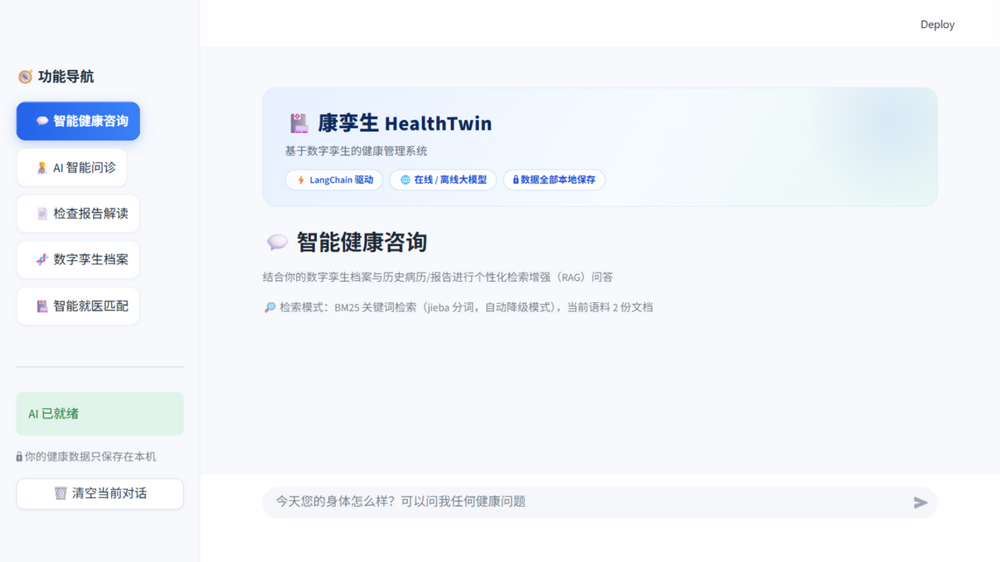
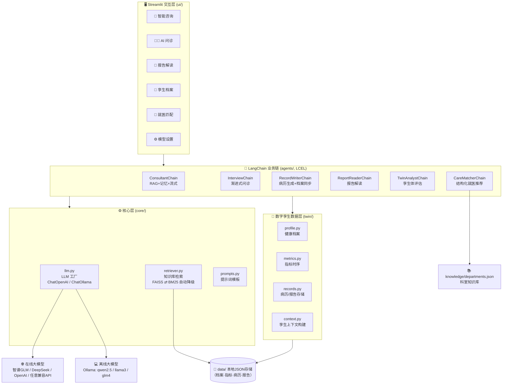
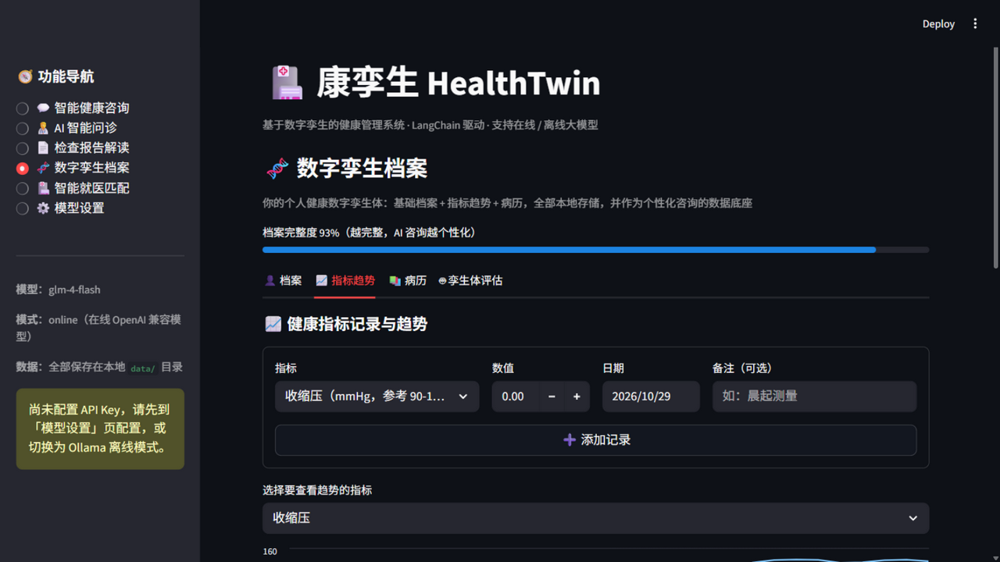
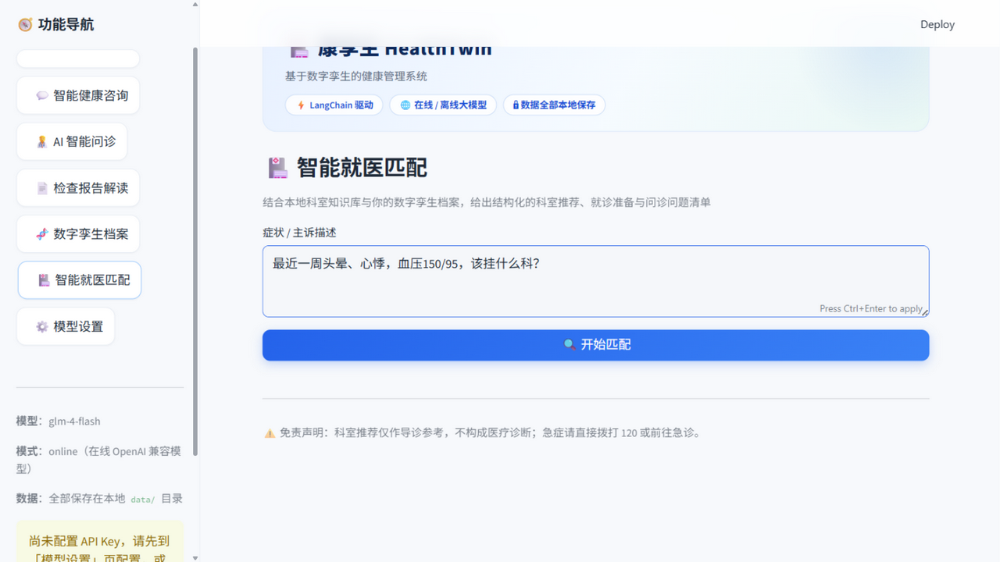
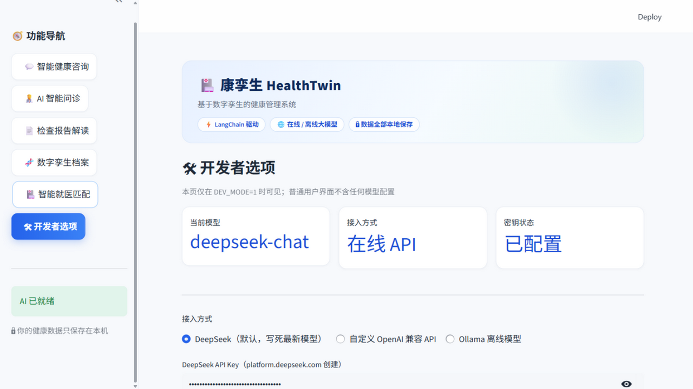

# 🏥 康孪生 HealthTwin

**基于数字孪生的健康管理系统** —— 一款基于 **LangChain 框架**开发、支持**在线大模型 / 离线大模型**双模式的智能健康管理应用。

> 数字孪生健康档案 × AI 智能分析 × 智能就医匹配
> 打通「数据采集 → 数字建模 → 智能分析 → 精准服务 → 就医衔接」的全周期健康管理闭环

<p align="center">
  
</p>

---

## 目录

- [项目简介](#项目简介)
- [功能特性](#功能特性)
- [系统架构](#系统架构)
- [LangChain 技术要点](#langchain-技术要点)
- [快速开始](#快速开始)
  - [方式一：在线大模型（推荐，5分钟跑通）](#方式一在线大模型推荐)
  - [方式二：离线大模型（Ollama，数据不出本机）](#方式二离线大模型ollama)
- [配置说明](#配置说明)
- [使用指南](#使用指南)
- [目录结构](#目录结构)
- [数据与隐私](#数据与隐私)
- [运行测试](#运行测试)
- [与原课设版本的升级对照](#与原课设版本的升级对照)
- [免责声明](#免责声明)
- [开源许可](#开源许可)

---

## 项目简介

现有健康管理产品普遍停留在「数据记录 + 简单提醒」层面，技术应用浅、功能碎片化，且缺少健康数据与就医服务的衔接闭环。**康孪生 HealthTwin** 以「数字孪生」为核心概念，为每位用户构建一个随数据持续更新的**个人健康数字孪生体**，并用 LangChain 编排大模型能力，围绕孪生体提供个性化分析与就医指导。

系统三大核心模块（对应《基于数字孪生概念的健康管理系统》项目规划）：

| 模块 | 说明 |
| --- | --- |
| 🧬 **数字孪生健康档案** | 基础档案 + 血压/血糖/心率/体重/睡眠等多维指标时序 + 历史病历 + 检查报告，本地持久化，可视化趋势，形成与用户健康状态同步的数字孪生体 |
| 🤖 **AI 智能分析** | 基于 RAG 检索个人健康资料的智能咨询、AI 模拟问诊并自动生成规范病历、检查报告解读、孪生体综合健康评估（画像/风险分层/干预建议） |
| 🏥 **智能就医匹配** | 本地科室知识库（30+ 科室）关键词命中作确定性 grounding + LLM 结构化输出，给出就诊科室推荐、紧急程度分级、就诊准备清单与问诊问题清单 |

## 功能特性

### 💬 智能健康咨询（RAG）
- 每次提问自动检索你的**病历、报告、孪生档案**（BM25 / FAISS 双引擎自动切换）
- 注入数字孪生上下文（基础档案 + 近 90 天指标趋势），回答高度个性化
- 流式输出，多轮对话记忆

### 🧑‍⚕️ AI 智能问诊 → 病历生成 → 档案自动同步
- AI 医生按照真实门诊流程**循序渐进问诊**（一般信息 → 主诉 → 现病史 → 既往史 → 个人史 → 家族史）
- 一键生成**十要素规范门诊病历**
- 生成后自动从病历中抽取年龄/性别/慢病/过敏史等字段，**回写同步到数字孪生档案**，并把病历纳入 RAG 知识库

### 📄 检查报告解读
- 支持上传 PDF（自动抽取文本）/ TXT，或直接粘贴
- 输出报告摘要、异常指标解读、健康/就医建议、复查计划
- 报告自动归档进知识库，后续咨询可直接引用

### 🧬 数字孪生档案
- 档案完整度进度条（越完整，AI 越懂你）
- 7 类日常指标记录与趋势折线图
- 一键生成《数字孪生体健康评估报告》：孪生体画像、指标趋势分析、风险分层、个性化干预建议、监测计划、就医提醒

### 🏥 智能就医匹配
- 输入症状 → 本地知识库确定性命中 + LLM 结构化分析
- 输出：紧急程度（常规/尽快/⚠️紧急）、推荐科室 Top3（含理由）、红旗警示信号、就诊准备清单、建议咨询医生的问题

### ⚙️ 模型设置
- 图形化切换**在线 API / Ollama 离线**模式，内置智谱 GLM / DeepSeek / OpenAI / wisediag 预设
- 一键连通性测试、RAG 知识库状态查看

## 系统架构



## LangChain 技术要点

本项目严格基于 LangChain（0.3.x）框架开发，业务代码只依赖 `BaseChatModel` 抽象，可无缝切换模型供应商：

| LangChain 组件 | 使用位置 |
| --- | --- |
| **LCEL 链组合**（`prompt \| llm \| parser`） | 全部业务链 |
| `ChatPromptTemplate` + `MessagesPlaceholder` | 咨询/问诊多轮对话记忆注入 |
| `ChatOpenAI`（langchain-openai） | 在线模式：任意 OpenAI 兼容 API |
| `ChatOllama`（langchain-ollama） | 离线模式：本地大模型 |
| **流式输出**（`.stream()`） | 咨询与问诊打字机效果 |
| `FAISS` + `as_retriever`（langchain-community） | RAG 语义检索（配置向量模型时） |
| `BM25Retriever` + jieba 分词 | RAG 关键词检索（零配置默认，**自动降级**保证任何环境可用） |
| `with_structured_output`（Pydantic Schema） | 就医匹配结构化推荐、病历档案字段抽取 |
| 结构化输出降级（JSON Schema 提示词 + 宽松解析） | 供应商不支持工具调用时的兜底 |
| `Document` 元数据 | 病历/报告/档案来源标注，检索结果可溯源 |

**数字孪生闭环**：`AI 问诊 → 病历生成 → 结构化抽取档案字段 → 档案更新 → RAG 知识库重建 → 咨询更个性化`。

## 快速开始

### 环境要求

- Python **3.9+**
- （离线模式）[Ollama](https://ollama.com) 已安装

### 安装

```bash
git clone <本仓库地址>
cd health-twin
pip install -r requirements.txt
```

### 方式一：在线大模型（推荐）

使用任意 **OpenAI 兼容接口**。默认预设为智谱 GLM（`glm-4-flash` 有免费额度，去 [智谱开放平台](https://open.bigmodel.cn) 申请 API Key）：

```bash
cp .env.example .env
# 编辑 .env：
#   ONLINE_API_KEY=你的Key
streamlit run app.py
```

也支持 DeepSeek、OpenAI、原课设 wisediag 等，改 `.env` 里的 `ONLINE_BASE_URL` / `ONLINE_MODEL` 即可；或在应用内「⚙️ 模型设置」页图形化配置。

> 想要体验 `examples/sample_report.txt` 示例体检报告？进入「📄 检查报告解读」页粘贴其内容即可。

### 方式二：离线大模型（Ollama）

数据完全不出本机：

```bash
# 1. 安装 Ollama 后拉取模型（任选其一，首次约 4.7GB）
ollama pull qwen2.5:7b
# ollama pull llama3.1:8b
# ollama pull glm4:9b

# 2. 配置 .env
#   LLM_PROVIDER=ollama
#   OLLAMA_MODEL=qwen2.5:7b

# 3. 启动
streamlit run app.py
```

> Windows 用户可直接双击 `run.bat` 一键安装依赖并启动。

## 配置说明

`.env`（或应用内「模型设置」页）全部配置项：

| 变量 | 默认值 | 说明 |
| --- | --- | --- |
| `LLM_PROVIDER` | `online` | `online`（在线 API）/ `ollama`（离线本地） |
| `ONLINE_BASE_URL` | 智谱 | 任意 OpenAI 兼容接口地址 |
| `ONLINE_API_KEY` | — | 在线模式必填 |
| `ONLINE_MODEL` | `glm-4-flash` | 模型名 |
| `OLLAMA_BASE_URL` | `http://localhost:11434` | Ollama 服务地址 |
| `OLLAMA_MODEL` | `qwen2.5:7b` | 本地模型名 |
| `EMBEDDING_BASE_URL` | 空（用 BM25） | 配置后启用 FAISS 语义检索 |
| `EMBEDDING_MODEL` | 空 | 向量模型名（在线如 `embedding-2`；Ollama 模式自动用 `nomic-embed-text`） |
| `TEMPERATURE` | `0.7` | 生成温度 |
| `MAX_TOKENS` | `2048` | 最大生成 token |
| `RETRIEVER_TOP_K` | `4` | RAG 检索条数 |

**RAG 双引擎说明**：配置了向量模型 → FAISS 语义检索；未配置或不可达 → **自动降级 BM25 关键词检索**（jieba 分词），无需任何外部服务，离线环境同样具备 RAG 能力。

## 使用指南

| 页面 | 操作 | 背后发生什么 |
| --- | --- | --- |
| 💬 智能咨询 | 直接提问，如"我这血压趋势正常吗？" | 检索你的病历/报告/档案 + 孪生上下文 → 流式个性化回答 |
| 🧑‍⚕️ AI 问诊 | 点「开始 AI 问诊」逐轮回答 → 点「生成病历」 | 渐进式问诊 → 十要素病历 → 抽取字段同步档案 → 病历入库 |
| 📄 报告解读 | 上传 PDF/TXT 或粘贴 → 点「AI 解读」 | 结构化解读 + 归档进知识库 |
| 🧬 孪生档案 | 填档案 / 记指标 / 看「指标趋势」/ 点「孪生体评估」 | 指标趋势图 + 综合健康评估报告 |
| 🏥 就医匹配 | 描述症状 → 点「开始匹配」 | 知识库命中 + LLM 结构化推荐（科室/紧急度/准备清单/问题清单） |

截图速览：

| 数字孪生指标趋势 | 智能就医匹配 | 模型设置 |
| --- | --- | --- |
|  |  |  |

## 目录结构

```
health-twin/
├── app.py                  # Streamlit 入口 + 模型/知识库缓存 + 页面路由
├── config.py               # 全局配置（.env 加载、路径、参数）
├── requirements.txt
├── run.bat                 # Windows 一键启动
├── .env.example            # 配置模板
├── core/                   # 核心层
│   ├── llm.py              #   LLM 工厂（在线/离线）+ 结构化输出统一入口
│   ├── prompts.py          #   全部提示词模板（ChatPromptTemplate）
│   └── retriever.py        #   RAG 知识库（FAISS ⇄ BM25 自动降级）
├── twin/                   # 数字孪生数据层
│   ├── profile.py          #   健康档案（Pydantic 模型 + JSON 存储）
│   ├── metrics.py          #   指标时序存储 + 趋势摘要
│   ├── records.py          #   病历 / 报告存储
│   └── context.py          #   孪生上下文构建（注入提示词的数据视图）
├── agents/                 # LangChain 业务链（LCEL）
│   ├── consultant.py       #   RAG 咨询链（流式 + 记忆）
│   ├── interviewer.py      #   AI 问诊链
│   ├── record_writer.py    #   病历生成 + 档案自动同步
│   ├── report_reader.py    #   报告解读链 + PDF 文本抽取
│   ├── twin_analyst.py     #   孪生体综合评估链
│   └── care_matcher.py     #   就医匹配链（知识库 grounding + 结构化输出）
├── ui/                     # Streamlit 视图（每个功能页一个模块）
├── knowledge/
│   └── departments.json    # 科室-疾病/症状知识库（30+ 科室）
├── examples/
│   └── sample_report.txt   # 示例体检报告（演示用）
├── tests/
│   └── smoke_test.py       # 冒烟测试（无需 API Key）
├── docs/screenshots/       # 截图
└── data/                   # 运行时数据（gitignore，全部本地）
```

## 数据与隐私

- 所有健康数据（档案 / 指标 / 病历 / 报告）均以 JSON 形式保存在**本机 `data/` 目录**，不上传任何服务器
- 离线模式（Ollama）下，连模型推理都在本地完成，**数据完全不出本机**
- `.env` 与 `data/` 均已加入 `.gitignore`，不会被误提交

## 运行测试

```bash
python tests/smoke_test.py
```

覆盖：模块导入、档案读写与字段合并、指标趋势统计、病历/报告存储、BM25 检索降级、科室知识库命中、LLM 工厂双模式、结构化输出 JSON 降级解析、全部 LCEL 链的可执行性（FakeListChatModel 模拟）。**无需任何 API Key 即可运行**。

## 与原课设版本的升级对照

本项目由课设《康孪生智慧医疗》（Streamlit + OpenAI SDK 裸调）升级重构而来：

| 维度 | 原课设版本 | 本版本 |
| --- | --- | --- |
| 框架 | OpenAI SDK 直接调用 | **LangChain 0.3**（LCEL / Prompt / RAG / 结构化输出） |
| 模型 | 仅 wisediag 在线 API | 在线任意 OpenAI 兼容 API + **Ollama 离线**，图形化切换 |
| 检索 | 无（把 PDF 全文塞进消息） | **RAG**：FAISS 向量检索 / BM25 关键词检索自动切换 |
| 档案 | 无持久化健康档案 | **数字孪生体**：档案 + 指标时序 + 趋势图 + 评估报告，本地持久化 |
| 病历 | 手动生成、存 txt | 问诊 → 病历 → **结构化抽取自动同步档案** → 自动入 RAG 知识库 |
| 就医推荐 | 依赖外部网站爬虫（cookie 易失效） | 本地科室知识库 grounding + LLM 结构化输出，**离线可用** |
| PDF | 依赖外部 OCR API | pypdf 本地抽取（扫描件提示粘贴文本） |
| 工程 | 单目录脚本 | 分层架构（core/twin/agents/ui）+ 冒烟测试 + 结构化配置 |

## 免责声明

本系统输出的所有健康建议、指标解读、科室推荐均由大模型生成，**仅供健康管理参考，不构成医疗诊断**。如有不适请及时就医，急症请直接拨打 120 或前往急诊。

## 开源许可

[MIT License](LICENSE) © 2026 HealthTwin Authors

---

**开源仓库**：https://github.com/serendipityovo/health-twin

如果这个项目对你有帮助，欢迎 Star ⭐ 支持！
